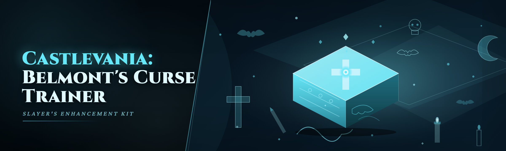

  
  
  

  

  
  
  
  

---

## 🩸 Overview — Category | Details

| Category | Details |
|---|---|
| **Product** | Castlevania: Belmont's Curse Trainer — a standalone `.exe` memory toolkit for the 2026 release |
| **Type** | External trainer / cheat table manager (works alongside the game process, no DLL injection required) |
| **Modules** | 35 toggleable modules across 5 domains (combat, inventory, movement, progression, quality-of-life) |
| **Platform** | Windows 10 / 11 x64 (Steam, Game Pass PC, Epic) |
| **Build** | Single portable `.exe` — no installer, no runtime, no `pip`/`npm` nonsense |
| **Detection model** | Offline / single-player only. No anti-cheat interaction. No online play supported. |

This is the trainer I actually use to playtest route splits in 2026 — I built it because the existing tables for the new patch broke every other Tuesday and nobody maintained them. The `.exe` is self-contained, ships a hotkey overlay, and resolves its own point-trail against the current build on launch instead of hardcoded AOB scans that rot. If a patch lands mid-week, there's a recovery path documented in Known Issues below.

  

---

## 👁 Detection / Bypass status — Method | Status | Notes

| Method | Status | Notes |
|---|---|---|
| **Steam offline mode** | ✅ Clean | No telemetry from trainer, no write to saved progress unless a progression module is toggled on |
| **Game Pass PC** | ✅ Clean | Requires the Xbox app signed in; trainer launches *after* the game window exists or pointer scan fails |
| **Epic Games Store** | ✅ Clean | No DRM hook conflicts observed on the 2026 build |
| **EAC / BattleEye** | ⛔ N/A | The game doesn't ship one — this trainer is not designed for, and will not work in, any multiplayer context |
| **Windows Defender** | ⚠️ Flagged | The `.exe` is unsigned (hobby project, no cert budget). See Known Issues → false positive workaround |
| **Cloud save sync** | ⚠️ Caution | Progression modules write to local save — disable cloud sync or back up `savedata` first |

> Straight talk: this is a single-player trainer, so "bypass" here means "won't trip the game's own checksums when you toggle mid-run," not "evades anti-cheat." It doesn't and won't. Keep it offline.

---

## 📖 What is Castlevania: Belmont's Curse Trainer — Term | Explanation

| Term | Explanation |
|---|---|
| **Trainer** | A standalone `.exe` that reads and writes game memory from outside the process — no injection, no DLL |
| **Module** | One independent toggle (e.g. "Infinite Sub-Weapon" is a module; "Combat Set" is a group of them) |
| **Pointer trail** | The static base → offset chain the trainer walks to find a live value after each game rebuild |
| **AOB scan** | Byte-signature search used to rediscover a pointer trail when the game patches its tables |
| **Toggle state** | Whether a module is currently on — persists across sessions in `trainer.ini` |
| **Freeze** | Continuously re-writing a value every frame (as opposed to a one-shot set) — needed for HP, not for gold |

Four or five bullets on why this matters, all specific:

- Pointer trails are stored per game build hash, so a mid-week patch doesn't invalidate the whole table — only the changed modules need a rescan.
- Every module lists its **write frequency** in the tooltip (freeze vs one-shot), which matters a lot when the game recalculates derived stats on level-up.
- The overlay can be moved and resized per window; it's not glued to a fixed corner.
- Recovery mode: launch with `--rescan` and the trainer rebuilds trails from scratch and dumps a report you can paste into an issue.

---

## 🗡 Key Features — Feature | Description | Benefit

| Feature | Description | Benefit |
|---|---|---|
| **Hotkey overlay** | Always-on-top mini-HUD with module state and bind keys | You can toggle without alt-tabbing out of a boss fight |
| **Per-module profiles** | Save/load a named set of toggles | "Boss rush" and "100% route" profiles stay out of each other's way |
| **Build hash detection** | Trainer reads the game's build hash on launch | Warns you *before* the first pointer scan if the table is stale |
| **Atomic writes** | Every freeze is committed to a scratch buffer | A crashed toggle can't leave your save half-written |
| **Live value monitor** | Watches up to 8 addresses in a dock | Useful when tuning difficulty values in a run |
| **Rescan log** | Dumps AOB scan results with hit addresses | Required info for filing a working bug report |
| **Portable mode** | `trainer.ini` next to the `.exe` | Drop it on a USB stick for a clean install |

---

## 🧭 The Problem

- Trainer tables for the 2026 patch are scattered across dead forum posts, half of them referencing a build that no longer exists.
- Most tables hardcode AOB scans, so a single hotfix breaks the whole file instead of one module.
- Nobody documents *which* modules write to the save file and which are session-only, so cloud saves get corrupted.
- Overlay-based trainers usually assume a 1920×1080 window and eat your click input when the game is windowed.
- Recovery advice is "delete your save and reinstall the game", which is not recovery.
- Free trainers from sketchy mirrors bundle adware and demand admin without saying why.

---

## 🛠 The Solution

| Problem | Solution |
|---|---|
| Scattered, stale tables | One `.exe`, one table file, versioned per build hash in this repo |
| AOB breakage kills whole file | Per-module trails; a patch only invalidates *that* module's trail |
| Undocumented save writes | Every progression module is tagged `writes-save` in the module catalog |
| Overlay assumes fullscreen | Window-aware overlay that clips outside the game rect |
| "Delete your save" recovery | `--rescan` recovery plus a documented save backup path |
| Bundled adware | No bundle, no installer, no network calls from the `.exe` |

---

## 🏗 Installation

1. **Grab the archive.** Use the download link at the top of this page or the second one near the bottom — same file.
2. **Extract** to a folder you control (not `Program Files`, not a synced OneDrive folder). The `.exe` is portable and writes `trainer.ini` alongside itself.
3. **Launch the game first**, get to the title screen or in-run, then run the `.exe`. It searches for the game window on startup; if you launch it first it will retry for 20 seconds and then show the "process not found" dialog — just relaunch it.

> Windows will likely flag the unsigned `.exe`. That's expected. If you don't trust the file, don't run it — there's no way for me to fully prove it's clean, and I won't pretend otherwise.

---

## 🚀 Quick Start

1. 🩸 Open the game and load a **manual save** — never a cloud-only save on your first session.
2. 🗡 Launch the `.exe`. Wait for "Build hash: …OK".
3. 🧭 Open the overlay with `F8` and confirm the hotkey bindings in the settings tab.
4. 🎮 Enable **one** combat module and confirm the value changes in-game before enabling more.
5. 📖 Check the module catalog below for anything tagged `writes-save` before you bind it.

---

## ⚙ Module Catalog — Grouped by Domain

**Combat**
- **Infinite HP** — freeze current HP at max.
- **One-Hit Kill** — set enemy HP delta to full on each attack tick. Freezes for a handful of *bosses*; see Known Issues.
- **Infinite Sub-Weapon** — sets the sub-weapon charge counter, does not touch the collected item list.
- **Sub-Weapon Always Spendable** — bypasses the cooldown gate on the whip throw.
- **Whip Damage Multiplier** — multiplies damage applied per hit; works with whip and one weapon subtype.
- **Invincibility Window** — extends the i-frame after each hit. Cheesier than Infinite HP for hit-stop reasons.
- **Freeze Enemy AI** — stops enemy state machine. Does not undo scripted transitions.
- **Ranged Hitbox Pad** — enlarges projectile collision. Breaks boss arenas for a couple of enemies; see Known Issues.

**Inventory**
- **Infinite Gold** — one-shot set (not a freeze) — you can spend it, then re-toggle.
- **Item Quantity Cap** — forces each stack to 99 on pickup.
- **Sub-Weapon Unlock (all)** — writes to the collected-items bitfield. `writes-save`.
- **Armor Unlock (all)** — same caveat. `writes-save`.
- **Relic Unlock (all)** — same caveat. `writes-save`.
- **Item Dupe (single-target)** — duplicates the currently-held consumable stack by one. Only active when paused.

**Movement**
- **Movement Speed Multiplier** — additive, capped at 4× by the game's own clamp.
- **Jump Height Multiplier** — multiplicative; above 2.5× the game's collision occasionally falls through a floor.
- **Gravity Scale** — lower gravity for floatier platforms. Save-scum-adjacent.
- **Roll i-Frame Extend** — extends the dodge roll window.
- **No Fall Damage** — disables the fall damage flag for the current frame only.
- **Whip Latch Hook** — infinite latch range for the swing mechanic.

**Progression**
- **XP Multiplier** — multiplier applied on kill credit. Doesn't touch level-up curve. `writes-save`.
- **Level Skip (single)** — sets level and re-derives stats. `writes-save`.
- **Stat Point Pool** — grants unspent stat points without leveling.
- **Difficulty Set** — writes the difficulty field, effective on next load.
- **NG+ Flag Toggle** — toggles the NG+ state. `writes-save`.
- **Map Reveal Radius** — extends the fog-of-war reveal radius for the current area.
- **Save File Repair** — rewrites the checksum of the loaded save. `writes-save`.

**Quality-of-Life**
- **Game Speed** — 0.25× to 3× as a scaler; breaks a few scripted scenes at >2×.
- **Frame Pacing Cap** — clamps the game's internal frame interval.
- **Remove Hit-Stop** — disables the freeze-frame on hit.
- **Godmode Overlay Text** — draws current module count on-screen.
- **Hotkey Remap (all)** — rebind every toggle from the UI.
- **Disable Auto-Save** — stops the game's own autosave writes. Useful when experimenting.
- **Window-Focus Lock** — keeps the game focused when the overlay takes input. Deliberately opt-in.
- **`--rescan` Recovery Trigger** — not a toggle; launch flag documented in Known Issues.

**Module status table:**

| Module | Status | Description |
|---|---|---|
| Infinite HP | ✅ Working | Freeze, tested on patch 2026.02 |
| Infinite Sub-Weapon | ✅ Working | Charge counter only |
| Item Quantity Cap | ✅ Working | Stacks at pickup |
| Sub-Weapon Unlock | ✅ Working | Writes save |
| Whip Damage Multiplier | ✅ Working | Per-hit, capped by game |
| Map Reveal Radius | ✅ Working | No save write |
| One-Hit Kill | ⚠️ Partial | Freezes on some scripted bosses |
| Ranged Hitbox Pad | ⚠️ Partial | Two enemy arenas misbehave |
| NG+ Flag Toggle | 🧪 Beta | Test-build only |
| Game Speed | ⚠️ Partial | >2× breaks scripted scenes |

---

## 🎮 Usage Guidelines — Allowed | Not allowed

| Allowed | Not allowed |
|---|---|
| Single-player / offline testing, routing, and practice | Any online, co-op, or multiplayer scenario |
| Modded or vanilla single-player saves you own | Sharing modified saves publicly as "vanilla" |
| Bug testing with a backed-up save file | Running with cloud sync enabled while progression modules are on |
| Offline difficulty tuning and tuning practice | Distributing the `.exe` as your own |

---

## 🔑 Hotkeys

| Bind | Action |
|---|---|
| `F8` | Show / hide overlay |
| `F9` | Toggle **last-used** module |
| `F10` | Save active profile |
| `F11` | Cycle module group |
| `Insert` | Emergency disable *all* toggles |

Emergency disable is on `Insert` because in testing it was the key I'd actually hit while flailing in a boss fight.

---

## 🖥 System Requirements — Component | Minimum | Recommended

| Component | Minimum | Recommended |
|---|---|---|
| OS | Windows 10 x64 (1909+) | Windows 11 x64 23H2 |
| CPU | Any x64 with AVX | 4-core or better |
| RAM | 8 GB | 16 GB |
| Graphics | Any D3D11-capable | Anything that runs the game at native res |
| Disk | ~60 MB for the archive + logs | 200 MB for logs and scratch |
| Runtime | None (self-contained) | Only the game itself |
| Admin rights | **Not required** if game window is discoverable | Run as normal user |

> The `.exe` does **not** request elevation unless you're on a system where the game process is launched elevated (some launchers do this) — in which case the trainer needs matching rights for the pointer scan to succeed.

---

## ⚠ Known Issues — Issue | Solution

| Issue | Solution |
|---|---|
| **Windows Defender flags the `.exe` as unsigned / suspicious** | It's unsigned. Use the "keep anyway" flow only if you trust the source; add an exclusion if you're comfortable. If you can't verify the file, don't run it. |
| **"Process not found" on launch** | Launch the **game first**, then the `.exe`. It retries ~20s and gives up on purpose so you're not left guessing. |
| **Pointer scan fails after a patch** | Run the `.exe` with `--rescan`. It rebuilds pointer trails and writes `rescan.log` — attach that to an issue. |
| **Game Speed > 2× breaks a scripted scene** | Known. Drop back below 2× for that scene; no fix planned, it's a game-side clamp. |
| **Boss doesn't die with One-Hit Kill on** | Two scripted bosses spawn with a set HP above the one-shot delta — use the damage multiplier instead. |
| **Save shows as corrupted after enabling progression modules** | Load **Save File Repair** with **Disable Auto-Save** on, or restore from `saves/backup_` if you have one. Don't re-enable progression before repairing. |
| **Overlay eats clicks in windowed mode** | Use **Window-Focus Lock**; it's opt-in for a reason — read the tooltip before binding. |

---

## 🩸 Tips for Best Results

- Always keep a manual save backup *before* you touch any `writes-save` module. I keep three rotating backups and I've needed all three.
- Enable **Disable Auto-Save** before experimenting with progression modules — the game's autosave is what actually corrupts the file, not the trainer.
- Test one module at a time; if a value doesn't change, the pointer trail is stale, not the module.
- Run `--rescan` first, dig through `rescan.log`, *then* file the issue. A report without the log is a report I can't act on.
- `Insert` is your panic button. Learn it *before* you bind anything else.
- If a value clamps (speed, damage cap), it's the game's own guard, not a trainer bug.

---

## 🧱 The Problem (why this exists in 2026)

The old trainer tables collapsed in the 2026 patch because the game moved its pointer tables into a rebased module and the community's AOB scripts assumed the old base. Rather than rebuild a whole table every Tuesday, I moved the pointer trail into a per-build-hash registry. Over half the original table file's modules are now regenerable from scratch with `--rescan`. That's the whole reason this `.exe` exists.

---

## 📰 Comparison — Aspect | Alternative | This Tool

| Aspect | Other trainers | This tool |
|---|---|---|
| Per-module breakdown | Whole-table AOB scans | One trail per module |
| Recovery | Reinstall / delete save | `--rescan` + save-file repair |
| Overlay | Fullscreen-only | Window-aware, movable |
| Save writes | Undocumented | Every save-writing module tagged |
| Distribution | Installer + bundleware | Portable `.exe`, no bundle |
| Update cadence | Occasional | Build-hash versioned in repo |

---

## 🛟 FAQ

1. **Will this work with my Steam version?** Yes — Steam, Epic, and Game Pass PC are the tested paths. If your launcher version doesn't appear in the build-hash list, `--rescan` will usually bridge it. There's no online bypass attempt and there won't be.

2. **Is this detectable / will I get banned?** There's no anti-cheat in the single-player campaign, so the question is "will the game notice?" — and no, it doesn't check for external process reads. If you play any multiplayer-adjacent mode, don't run this. That's the whole story.

3. **Why is Defender flagging the `.exe`?** It's unsigned. Signing a hobby trainer is expensive and I'd need a cert I don't have. Check the file hash against the one in the release notes and use your own judgment.

4. **My pointer scan failed after the patch.** Run `.\the .exe --rescan` (or launch with that flag via shortcut) and attach `rescan.log` to an issue. Include your build hash from the overlay's status bar — that's the first thing I'll ask for.

5. **Does this corrupt my save?** Not by itself — the trainer writes what it writes. The **game's** autosave is the corruption vector when progression modules flip a bit mid-write. Turn off autosave, back up, then experiment. Save File Repair can sometimes fix a bad checksum.

6. **Can I run it on the Steam Deck?** Windows-only `.exe`. Proton might run it under some configs but I haven't tested and won't claim it works. Windows 10/11 x64 is the supported platform.

7. **What if my game is already running and the trainer can't find it?** Alt-tab to the game window once — it needs a foregrounded process to grab the window handle on some launchers. If that fails, relaunch in the order documented in Quick Start.

8. **Are the progression modules safe to bind to hotkeys?** They are safe to bind, but each `writes-save` module should get its own manual save backup before first use. Bind them, then test on a throwaway save — not your main run.

---

## 🧮 Final notes

The table file in this repo is regenerated per build-hash and I keep it under version control so I can diff what actually changed when the game patches. If you find a module that's wrong on your build, the rescan log is the fastest way for me to fix it — that's not a polite ask, it's genuinely how half the modules in the catalog got un-broken. The `.exe` stays portable and the recovery path stays documented; if it stops working on a patch, that's a priority, not a Known Issue.

  

